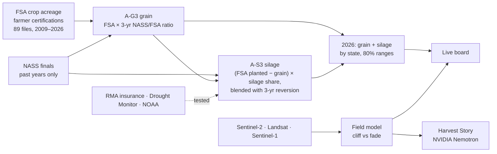

# Kernel 🌽 Silage or grain?

**Team Kernel · Hack the Harvest 2026 (USDA NASS × NVIDIA, UC Davis)**

USDA asked for two numbers: how many acres of this year's corn will be harvested **for grain** and how many **for silage**, for every state, **before January**. NASS publishes its first official silage count in January, after the markets have already moved. Kernel produces both numbers by mid-November. It builds them from public data, mostly from what farmers certify to USDA's Farm Service Agency each summer, and checks individual fields from space.

| | |
|---|---|
| 🗺️ **Live board** (try it now, no install) | **[rakd23-kernel-board.hf.space](https://rakd23-kernel-board.hf.space)** |
| 🎞️ **Slides** | **[pitch.com/v/kernel-hack-the-harvest-2026-knd2t7](https://pitch.com/v/kernel-hack-the-harvest-2026-knd2t7)** |
| 📓 **Submission notebook** | [`jupyter/workspace/Kernel_Submission/kernel_deliverable.ipynb`](jupyter/workspace/Kernel_Submission/kernel_deliverable.ipynb) |
| 📊 **2026 numbers, every state** | [`test_models/ownModels/silage/out/forecast_2026.csv`](test_models/ownModels/silage/out/forecast_2026.csv) · [`test_models/ownModels/grain/out/forecast_2026.csv`](test_models/ownModels/grain/out/forecast_2026.csv) |

---

## The answer for 2026

> **6.6% silage · 93.4% grain** of harvested corn acres

| | Silage | Grain |
|---|---|---|
| **US acres, 2026** | **6.30M** (80% range 6.02–6.80M) | **88.69M** (80% range 87.10–90.31M) |
| **Share of harvested corn** | **6.6%** (2025 actual: 6.4%) | **93.4%** (2025 actual: 93.6%) |
| Model | A-S3 · FSA residual | A-G3 · FSA ratio, 3-year |
| Uses NASS data from 2026 | No | No |

The answer doesn't depend on which model you pick: Tier A, Tier B and the submitted deliverable (`data/models/deliverable_2026.csv`) all give **6.6% silage**. Our grain total is within **0.2%** of NASS's November figure (88.51M), and we got there without NASS's current-year survey.

| Top silage states | Silage | Grain | Silage share 2026 | 2025 actual |
|---|---|---|---|---|
| Wisconsin | 836K | 3.15M | 21.0% | 21.6% |
| New York | 476K | 556K | 46.1% | 53.2% |
| South Dakota | 427K | 5.91M | 6.7% | 5.8% |
| Minnesota | 373K | 8.36M | 4.3% | 4.1% |
| California | 354K | 56K | 86.2% | 83.1% |
| Michigan | 336K | 1.96M | 14.6% | 14.7% |
| Pennsylvania | 326K | 685K | 32.3% | 32.8% |

## Headline results

Every number below comes from a backtest that pretends it is that date in each past year, uses only files published by then (checked file by file against their publication dates), and scores against NASS's final count released the following January. Lower is better.

| | Result | Backtest |
|---|---|---|
| 🥇 **Beats NASS in September** | Grain: **1.75%** average state miss vs NASS's own September forecast at **2.53%** | 2017–2024 |
| 🤝 **Ties NASS in November** | Grain: **1.76%** vs **1.66%**. The difference is +0.10, with a 90% interval of −0.07 to +0.26, so it's a statistical tie | 2017–2024 |
| 📈 **Silage where NASS has nothing** | A-S3: **12.52%** vs 13.12% for our previous model, better in **7 of 8** years | 2017–2024 |
| 🛰️ **Field check from space** | Trained only on Quebec fields, it found **10 of 12** silage fields on a Maryland farm it never saw (84% of 44 field-years right) | 2021–2023 |
| 🔍 **Audited** | Independent audit agents rebuilt every selected model from the raw files and reproduced every reported number | — |

**State miss** = sum of each state's absolute error ÷ actual acres, averaged over the years. **US miss** = error of the national total.

---

## How it works



**The key idea:** by the mid-July reporting deadline, farmers have already told USDA's Farm Service Agency (FSA) how much corn they planted and what it's for. The FSA files cover about 96–98% of the corn NASS counts. We anchor that to how FSA has compared with NASS's final counts in past years. That's enough to match NASS in November and beat it in September. Grain is the large, stable number. Silage is the small remainder, and that's why silage is the harder of the two.

---

## Every model, explained

We wrote down every candidate, its inputs and the selection rule **before any score was computed** (the silage rules are hashed into `out/preregistration.sha256`). The rule is mechanical: lowest backtest error, and a more complex model must beat the simplest one by more than **twice the year-to-year noise**.

### Tier A: no current-year NASS data
Past NASS finals anchor the model. Everything about the current year comes from FSA, RMA crop insurance, the Drought Monitor and NOAA. Code enforces the tiers: every input source carries a tier tag, and `check_tiers()` raises an error if a Tier A candidate reaches for anything above Tier A.

**Grain** · [`test_models/ownModels/grain/`](test_models/ownModels/grain/)

| ID | Model | How it works | 2012–24 state / US | 2017–24 state / US | Result |
|---|---|---|---|---|---|
| A-G1 | FSA ratio | Acres certified for grain this year × last year's NASS/FSA grain ratio | 2.15% / 1.15% | 1.97% / 0.93% | not selected |
| A-G2 | FSA planted share | FSA all-corn planted × last year's NASS grain / FSA planted | 2.24% / 1.19% | 2.06% / 1.01% | not selected |
| **A-G3** | **FSA ratio, 3-year** | **Like A-G1, with the median ratio of the last three years** | **1.94% / 1.12%** | **1.76% / 1.09%** | ✅ **selected** |
| A-G4 | FSA ratio + stress | A-G1 corrected by drought and insurance losses | 2.15% / 1.25% | 1.96% / 1.05% | stress adds 0.00 |
| A-G5 | FSA ratio, same month | Ratio against last year's FSA file from the same point in the season | 2.24% / 1.29% | 1.98% / 0.99% | not selected |
| — | NASS November forecast | benchmark | 1.61% / 0.58% | 1.66% / 0.82% | |

**Silage** · [`test_models/ownModels/silage/`](test_models/ownModels/silage/)

| ID | Model | How it works | 2012–24 | 2017–24 | Result |
|---|---|---|---|---|---|
| A-S1 | Reversion | Last year's acres pulled toward the 3-year average | 14.11% / 4.85% | 13.01% / 3.73% | baseline |
| A-S2 | FSA pass-through | FSA's silage change where FSA historically captures ≥75% of silage; A-S1 elsewhere | 14.33% / 5.07% | 13.03% / 4.12% | not selected |
| **A-S3** | **FSA residual** | **FSA planted − our grain estimate, × last year's silage share of non-grain acres, blended with A-S1** | **13.72% / 4.96%** | **12.52% / 4.00%** | ✅ **selected** |
| A-S4 | Reversion + switch signals | A-S1 adjusted by drought, insurance losses, FSA and insured-silage changes | 14.51% / 5.39% | 14.15% / 4.17% | worse |
| A-S5 | FSA silage share | Change in FSA's silage share applied to last year | 20.03% / 8.23% | 19.72% / 8.22% | much worse |
| A-S6 | Pass-through + switch | A-S2 in high-coverage states, A-S4 elsewhere | 14.48% / 5.29% | 13.97% / 4.14% | worse |

### Tier B: NASS-informed
Tier A plus current-year NASS inputs that aren't the answer: planted acres, the yield forecast, crop condition and progress, and milk cows. It **never** uses NASS's harvested-for-grain forecast.

**Grain** · [`test_models/ownModels/tierB/grain/`](test_models/ownModels/tierB/grain/)

| ID | Model | How it works | 2012–24 | 2017–24 | Result |
|---|---|---|---|---|---|
| B-G0 | Planted × last year's share | NASS planted × last year's grain share | 2.24% / 1.04% | 2.15% / 1.12% | baseline |
| B-G1 | Planted × FSA grain share | × this year's FSA grain share × last year's correction | 2.18% / 1.06% | 2.09% / 1.07% | not selected |
| B-G2 | Grain-share regression | Ridge on FSA share change, yield shock, drought, condition, losses | 2.18% / 1.09% | 2.11% / 1.18% | no gain |
| B-G3 | Monotone boosted trees | Same inputs, directions fixed in advance | 2.24% / 0.99% | 2.05% / 0.88% | no gain |
| B-G4 | Daniel's GBT (reference) | Earlier team model ([`danielModel`](test_models/danielModel/)) | 2.55% / 1.61% | 2.20% / 1.23% | reference |
| B-G5 | B-G1, 3-year | Median correction of the last three years | 1.92% / 0.91% | 1.75% / 1.03% | not selected |
| B-G6 | B-G1 + stress | Corrected by stress signals | 2.19% / 1.07% | 2.12% / 1.15% | no gain |
| **B-G7** | **Blend** | **Geometric mean of B-G5 and A-G3** | **1.89% / 1.01%** | **1.73% / 1.06%** | ✅ **selected** |

**Silage** · [`test_models/ownModels/tierB/silage/`](test_models/ownModels/tierB/silage/)

| ID | Model | How it works | 2012–24 | 2017–24 | Result |
|---|---|---|---|---|---|
| B-S0 | Reversion | Same as A-S1 | 14.11% / 4.85% | 13.01% / 3.73% | baseline |
| B-S1 | + acreage | Adds planted change and FSA non-grain share change | 14.03% / 5.10% | 12.91% / 4.00% | failed rule |
| B-S2 | + season stress | Adds yield shock, drought, condition, insurance losses | 13.84% / 4.75% | 13.09% / 3.94% | failed rule |
| B-S3 | + dairy demand | Adds milk-cow change and FSA silage change | 14.11% / 4.92% | 12.89% / 4.00% | failed rule |
| B-S4 | Monotone boosted trees | On the B-S2 and B-S3 inputs | 14.77% / 5.65% | 14.46% / 4.95% | worse |
| B-S5 | Residual | NASS planted − Tier B grain, × last year's silage share | 13.80% / 4.96% | 12.69% / 4.01% | not selected |
| **B-S5b** | **Residual, filled planted** | **B-S5 with FSA-scaled planted where NASS has only March figures** | **13.80% / 4.93%** | **12.65% / 3.94%** | ✅ **selected** |

**What the two tiers show:** NASS's current-year inputs add almost nothing. Tier B's best grain model beats Tier A's by only 0.03 points, and for silage Tier A is the better tier. Trained models (ridge, boosted trees) added nothing over simple ratios.

### Forecast timing

| Model | Sep 15 | Oct 15 | Nov 15 |
|---|---|---|---|
| A-G3 grain | **1.75%** / 0.92% | 1.76% / 0.95% | 1.76% / 1.09% |
| B-G7 grain | 2.08% / 1.08% | 1.72% | 1.73% / 1.06% |
| NASS forecast that date | 2.53% / 1.05% | 1.66% / 0.82% | 1.66% / 0.82% |
| A-S3 silage | 12.63% / 4.06% | 12.61% / 4.07% | 12.52% / 4.00% |

Our models stay nearly flat across the fall because FSA certifications are mostly complete by mid-July. NASS improves as its fall surveys come in.

### The report pipeline (`kernelag/`)
The package behind the deliverable, the reports and the field explorer.

| Module | What it does |
|---|---|
| `fsa.py` | Parses FSA crop acreage workbooks, with an as-of rule: only files published by the forecast date |
| `state_panel.py` | Builds the state × year panel (NASS history, drought, weather, condition, prices, milk cows) |
| `state_model.py` | The report models: ridge silage feature sets, the delivered `smoothed_chopping` silage level (`silage_level.py`: smoothed state level + drought chopping, parameters fit on earlier years only), and the NASS-anchored grain benchmark |
| `deliverable.py` | Writes `deliverable_2026.csv`, `deliverable_comparison.csv` (2017–2025 vs NASS finals) and `deliverable_summary.json` |
| `field_model.py` | Field silage-or-grain classifier (below) |
| `s2_series.py` · `landsat_series.py` · `s1_series.py` · `multisensor.py` | Sentinel-2, Landsat and Sentinel-1 radar time series via Earth Engine |
| `state_sample.py` | Draws 300 satellite sample areas of 10×10 km, 20 per state, in the 15 states with the most silage |
| `explain.py` | Harvest Story: Nemotron writes plain English, and code checks every number |
| `explorer.py` · `report.py` | Offline HTML pages: `report/index.html` (acreage) and `report/fields.html` (field explorer) |

### Field model: silage is a cliff, grain is a fade
[`kernelag/field_model.py`](kernelag/field_model.py) · tests in [`test_models/featureTests/`](test_models/featureTests/)

Silage and grain both lose their green around September 10, so harvest timing alone can't tell them apart. The **shape** of the drop can. Silage goes from green to bare in days (NDVI 0.80 → 0.22 in five days), while grain fades over weeks (0.81 → 0.33 over five weeks).

- **Model:** logistic regression on six harvest features that don't depend on the calendar: `max_drop`, `max_drop_rate`, `fade_days`, `green_at_cut`, `ndmi_before_cut`, `ndti_post`.
- **Train:** Quebec parcels where farmers declared grain or silage maize. **Test:** the organizers' 44 Maryland field-years (USDA Beltsville, 2021–2023), never used for fitting.

| On 44 Maryland field-years | Called silage | Called grain |
|---|---|---|
| Truly silage (12) | **10** | 2 |
| Truly grain (32) | 5 | **27** |

| Approach | Balanced accuracy | Notes |
|---|---|---|
| Always "grain" | 0.50 | finds 0 of 12 silage fields |
| Published September moisture rule | 0.677 | |
| **Kernel field model, 318 Quebec fields** | **0.839** | 10 of 12 found, 5 of 32 false alarms |
| Kernel field model, 3,128 Quebec fields | 0.854 | |
| + Landsat looks | 0.927 | passed the test, audit pending |

The 40–60 score band is sent to review (6 fields); the 38 confident calls are 35 right.

### Harvest Story (NVIDIA Nemotron)
[`kernelag/explain.py`](kernelag/explain.py)

Statisticians have to defend every number to markets. Python computes every fact about a field: the curve, the evidence weights and the call. **Nemotron 3 Super** (through NVIDIA's API, paid with Brev credits) turns those facts into two or three plain sentences. Code then flags any number in the story that doesn't appear in the facts. [`kernelag/nemotron_check.py`](kernelag/nemotron_check.py) runs Nemotron 3 Nano 4B on a local GPU, so USDA could host the model on its own servers.

```bash
python -m kernelag.explain --dry-run   # print two prompts, call nothing
python -m kernelag.explain             # all 44 Maryland field-years (needs NVIDIA_API_KEY in .env)
```

### Exploratory models (kept for the record)

| Folder | What it tried |
|---|---|
| [`danielModel/`](test_models/danielModel/) | Gradient-boosted trees and ridge regression on a shared state panel |
| [`varunModel/`](test_models/varunModel/) | Which public November signals cut silage error (hay, milk, cattle on feed, planted acres) |
| [`manrajModel/`](test_models/manrajModel/) | Two silage signals that looked promising and weren't |
| [`accuracy/`](test_models/accuracy/) | National and state candidates, plus the noise floor that promoted `smoothed_chopping` |
| [`codexFieldBaseline/`](test_models/codexFieldBaseline/) | Logistic vs XGBoost field models on identical Quebec spatial folds |
| [`featureTests/`](test_models/featureTests/) | One harness and one decision rule for new field features: dairy distance, heat units, moisture, radar, Landsat |
| [`testModel/`](test_models/testModel/) | Standard-library acreage baselines from the organizers' Quick Stats file |

---

## Set it up

### 1. Clone and install (Python 3.11+, [`uv`](https://docs.astral.sh/uv/))

```bash
git clone https://github.com/Severynson/Hack-the-Harvest.git
cd Hack-the-Harvest
uv venv .venv
uv pip install --python .venv/bin/python -r requirements.txt
```
On Windows, use `.venv\Scripts\python.exe` wherever this README says `.venv/bin/python`.

### 2. Rebuild the 2026 forecast

```bash
.venv/bin/python test_models/ownModels/grain/run.py          # Tier A grain: backtest, selection, 2026
.venv/bin/python test_models/ownModels/silage/run.py         # Tier A silage
.venv/bin/python test_models/ownModels/tierB/grain/run.py    # Tier B grain
.venv/bin/python test_models/ownModels/tierB/silage/run.py   # Tier B silage
.venv/bin/python -m kernelag.deliverable --lean              # the submitted deliverable files
```
Each `run.py` writes its backtest, its selection and `forecast_2026.csv` into its own `out/` folder. `--score-2025` scores the held-out year **once** and refuses to overwrite it.

### 3. Run the board locally
The board lives on the `board` branch. It reads the files the models already wrote, so nothing reruns, and it needs no GPU and no API key.

```bash
git fetch origin board
git checkout origin/board -- board
uv pip install --python .venv/bin/python fastapi uvicorn
.venv/bin/python board/app.py          # → http://localhost:7870
```
The board has eight views:
- **Map:** drag and zoom the US map, then switch layers for each model's forecast, county dairy and silage, weather, frost, harvest pace, crop value, milk price, highways, export routes and live satellite passes.
- **Tier A/B:** the planned candidates and the bars they have to clear.
- **Leaderboard:** every model ranked by backtest error.
- **Compare:** year-by-year errors for the models you tick.
- **2026 forecast:** every model's US total and states side by side.
- **Field models:** satellite field classifiers and their scores.
- **Add a model:** the recipe for publishing a new one.

The hosted copy at [rakd23-kernel-board.hf.space](https://rakd23-kernel-board.hf.space) pulls this repo every 5 minutes, so new results show up on their own.

**Add your model to the board** with one call:
```python
from board.publish import publish
publish("test_models/myModel/out",
        predictions=preds,   # columns: model, target (silage|grain), year, state, actual, predicted
        forecast=fc_2026)    # columns: model, target, state, predicted[, lo80, hi80]
```

### 4. Offline reports and tests

```bash
.venv/bin/python -m kernelag.evaluate
.venv/bin/python -m kernelag.report      # report/index.html: US and state acreage
.venv/bin/python -m kernelag.explorer    # report/fields.html: field explorer
.venv/bin/python -m pytest -q
```
Both HTML pages open straight from disk, with no server and no network.

The live satellite pullers (`s2_series`, `landsat_series`, `s1_series`, `state_sample`) need `earthengine-api` and Earth Engine access. The cached demo doesn't.

---

## Data

| Source | What we use | Tier A | Tier B |
|---|---|---|---|
| NASS final figures, past years | Grain and silage acres by state (training targets and anchors) | ✅ | ✅ |
| FSA crop acreage reports | Corn planted by county and intended use; monthly Aug–Jan; 89 workbooks 2009–2026 | ✅ | ✅ |
| RMA crop insurance | Insured corn acres by type; weather-loss claims | ✅ | ✅ |
| US Drought Monitor, NOAA | Severe drought share; season rain, heat, first frost | ✅ | ✅ |
| NASS current year | Planted acres, yield forecast, condition, progress, milk cows | ❌ | ✅ |
| NASS harvested-for-grain forecast | The number we're replacing | ❌ | ❌ |
| Sentinel-2, Landsat, Sentinel-1 | Field greenness, moisture and residue curves | field model | field model |
| Quebec parcel declarations · USDA Beltsville labels | Field training labels · held-out field test | field model | field model |

File-level provenance is in [`data/DATA_MANIFEST.tsv`](data/DATA_MANIFEST.tsv). Verified figures are in [`DOCS/VERIFIED_METRICS.md`](DOCS/VERIFIED_METRICS.md), and decisions in [`DOCS/DECISIONS.md`](DOCS/DECISIONS.md).

---

## Honest limits

- **NASS's November forecast is still better** over 2012–2024 (largely because of the 2012 drought year and 2014) and on the US total. We claim a tie for 2017–2024 and a win in September, not a November win.
- **Silage is noisy.** Silage is about 6–9% of corn, so a small grain error becomes a large error in the remainder. Even a model that knew this year's true non-grain acres would miss by 8.4% (2012–2024). A-S3's gain is in how acres are split between states, not in the US total (4.00% vs 3.90%).
- **"No current-year NASS data" isn't "data NASS doesn't use."** NASS draws on FSA records too.
- **The field test is small:** 44 field-years on one farm, with labels from a different country. The field score is uncalibrated, not a probability.
- **Satellite at state level is still running** (300 sample areas, rules fixed in advance). We claim no result yet.
- **The audit found one issue:** three FSA files had been assumed public a few days too early. November results are unaffected, and the September advantage holds for 2017–2024.
- **2025 was scored once,** after the methods were fixed. One year is information, not proof.

---

## Team

Team Kernel built this with a crew of coding agents working under one protocol. Agents must read [`CLAUDE.md`](CLAUDE.md) and follow its Git coordination rules before editing. [`CHANGELOG.md`](CHANGELOG.md) records every delivery. MIT licensed, see [`LICENSE`](LICENSE).

Built on **NVIDIA** (Nemotron, Brev) and **Keeboh** (team workspace and B200 GPU) for Hack the Harvest 2026.
