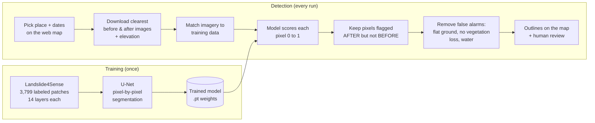

# Nepal Landslide Detector

A GeoAI system that finds **new landslides** in free satellite imagery. You give it a place and two date
ranges, before and after an event like a monsoon storm or an earthquake. It downloads Sentinel-2 images,
runs a deep-learning model on every pixel, and outlines the hillsides that collapsed in between, on an
interactive web map.

Built and tested on the **26–28 September 2024 monsoon storm** in central Nepal. That storm triggered
hundreds of landslides, including the Jhyaple Khola landslide on the Tribhuvan Rajpath highway, which
killed 35 people.

---

## How it works



1. **Data.** [Landslide4Sense](https://doi.org/10.5281/zenodo.10463239) provides 128 × 128-pixel patches at
   10 m per pixel, from several regions around the world. Each patch has 14 layers: 12 Sentinel-2 bands
   (including near-infrared, which shows healthy vegetation), slope, and elevation. Each also has a
   hand-drawn mask marking the landslide pixels.
2. **Model.** A U-Net does *semantic segmentation*, meaning it labels every pixel. Its encoder learns
   *what* is in the image, its decoder works out *where*, and skip connections keep the edges sharp.
   About 2% of pixels are landslides, so training uses a weighted loss plus a Dice loss to stop the
   model from predicting "no landslide" everywhere.
   - **v1:** a U-Net trained from scratch.
   - **v2:** a U-Net whose encoder is a ResNet34 pretrained on ImageNet (transfer learning), trained
     with photometric augmentation.
3. **Detection.** For any location, the pipeline:
   - picks the clearest before and after images using Sentinel-2's cloud layer
   - adds Copernicus elevation and slope
   - rescales the new imagery to match the training data (quantile matching)
   - slides a 128 × 128 window across the scene, averaging four flipped predictions per window
     (test-time augmentation)
   - keeps only landslides that are **new** in the after image
4. **False-alarm filters.** Each detection is measured and removed if it sits on gentle slopes (average
   below 10°), shows no vegetation loss (NDVI didn't drop by 0.10), or is mostly water. Removed
   detections are kept and shown on the map with the reason, so you can check the filters.
5. **Web app.** A FastAPI backend runs detections as background jobs and stores the results. A Leaflet
   frontend lets you pick places, watch progress, compare before/after imagery, and **review each
   detection** as real or a false alarm to measure real-world precision.

---

## Results

**Validation (Landslide4Sense, 570 held-out patches, pixel-level, same patches for every model)**

| Model | Threshold | Precision | Recall | F1 | IoU |
|---|---|---|---|---|---|
| v1 U-Net from scratch | 0.75 | 0.718 | 0.762 | 0.739 | 0.586 |
| v1 + test-time augmentation | 0.70 | 0.705 | 0.780 | 0.741 | 0.588 |
| v2 U-Net + ImageNet ResNet34 | 0.85 | 0.723 | 0.753 | 0.738 | 0.584 |
| v2 + test-time augmentation | 0.85 | 0.739 | 0.746 | **0.742** | **0.590** |

For reference, the best teams in the 2022 Landslide4Sense competition reached an F1 of roughly 0.7 on
the landslide class.

**Real-world (Jhyaple Khola, 26–28 Sep 2024 storm; images 22 Oct 2023 → 15 Dec 2024; same area and filters)**

| Model | Detections kept | Removed by filters | Reviewed | Real / false alarm | Precision (95% CI) |
|---|---|---|---|---|---|
| v1 | 91 | 4 | 30 | 27 / 3 | 90% (74–97%) |
| v2 | 104 | 10 | 31 | 29 / 2 | **94% (79–98%)** |

Real-world precision is **object-level** (does the outline sit on a real landslide?), not pixel-level
like the validation scores, so the two tables aren't directly comparable. Reviews were done by the
author on the largest detections in each run (via the app's *Review next*), so smaller detections may
differ. Recall wasn't measured because no public inventory for this event was available; `04_evaluate.ipynb`
computes it if one is supplied.

**What worked**
- About 9 in 10 flagged areas on real 2024 imagery were confirmed landslides, and nearly all
  detections with model confidence above 0.9 were real.
- Before/after change detection removed many of the model's false alarms, such as road cuts and
  riverbeds that are always bare.
- **Transfer learning didn't raise validation F1** (0.741 vs 0.742, within noise), likely because
  ImageNet's colour-photo filters transfer poorly to 14 mostly infrared/terrain layers. On real
  imagery, though, v2 flagged **14% more landslides at comparable precision** (94% vs 90%; the
  confidence intervals overlap, so the precision difference isn't significant).

**What didn't, and why**
- **Domain shift.** The model trained on Landslide4Sense imagery, which was processed differently from
  the Sentinel-2 L2A images used at detection time, and band B10 is missing from L2A, so validation
  scores can't simply be assumed to carry over to new imagery. Quantile matching, photometric
  augmentation, change detection and the false-alarm filters are the mitigations, and the manual
  review above is how their effect was checked.
- **Seasonal mismatch.** Comparing an October image with a December one adds shadow and vegetation
  changes that aren't landslides. Use the same months in both date ranges where possible.
- **Small and shadowed landslides** under about 10 pixels (1,000 m²), or on steep north-facing slopes,
  are often missed.

---

## Project structure

```
geoai/
├── 01_explore_landslide4sense.ipynb   Step 3: look at the data, save band statistics
├── 02_train_unet.ipynb                Step 4: train v1 (U-Net from scratch)
├── 02b_train_v2.ipynb                 Step 4b: train v2 (pretrained ResNet34), compare v1 vs v2
├── 03_detect_nepal.ipynb              Step 5: run detection on one area, step by step
├── 04_evaluate.ipynb                  Step 7: real-world accuracy from reviews / an inventory
├── webapp/
│   ├── app.py                         FastAPI backend: jobs, reviews, export
│   ├── pipeline.py                    the detection pipeline used by the app
│   └── static/index.html              Leaflet map frontend
├── deploy/                            Docker + Hugging Face Spaces deployment
├── data/TrainData/                    Landslide4Sense (download separately)
├── landslide_unet.pt, model_config.json         v1 model
├── landslide_unet_v2.pt, model_config_v2.json   v2 model
├── band_stats.npy, band_quantiles.npy           normalization statistics
└── runs/                              web app results (one folder per run)
```

---

## Running it

**Environment (macOS, Apple Silicon):**
```bash
conda create -n geoai python=3.11 -y && conda activate geoai
conda install -c conda-forge pytorch torchvision h5py numpy matplotlib jupyterlab \
    pystac-client planetary-computer odc-stac rasterio geopandas fastapi uvicorn \
    timm huggingface_hub safetensors -y
pip install --no-deps segmentation-models-pytorch
```
Install PyTorch from conda-forge, not pip. Mixing the two causes an OpenMP crash on macOS.

**Data:** download `TrainData.zip` from [Zenodo](https://zenodo.org/records/10463239) and unzip it into
`~/geoai/data/`.

**Notebooks:** run them in order in JupyterLab (`cd ~/geoai && jupyter lab`).

**Web app:**
```bash
cd ~/geoai/webapp
uvicorn app:app
```
Then open http://127.0.0.1:8000. Under **New detection**, choose an example event or click
**Pick on map**, set the dates, and click **Run detection**. A run takes a few minutes. Afterwards,
use **Review next** to mark detections and **Download GeoJSON** to export them.

**Deploy online (Hugging Face Spaces):** see [Deploying](#deploying).

---

## Deploying

The `deploy/` folder packages the web app as a Docker container for
[Hugging Face Spaces](https://huggingface.co/spaces). It's free and runs on CPU.

1. Create a Hugging Face account and a new Space with the **Docker** SDK (blank template).
2. Install Git LFS once: `brew install git-lfs`.
3. Clone your Space and copy everything into it:
   ```bash
   git clone https://huggingface.co/spaces/<your-username>/<space-name> ~/landslide-space
   bash ~/geoai/deploy/prepare_space.sh ~/landslide-space
   cd ~/landslide-space && git commit -m "Deploy landslide detector" && git push
   ```
   When `git push` asks for a password, use a Hugging Face **access token** with write permission
   (Settings → Access Tokens).
4. The Space builds for several minutes, then serves the app at
   `https://huggingface.co/spaces/<your-username>/<space-name>`.

The free hardware has no GPU, so runs are slower. Results are lost whenever the Space restarts.
`MAX_QUEUE` (default 3 on Spaces) limits how many runs can wait in line.

---

## Data and credits

- **Landslide4Sense:** Ghorbanzadeh, O., Xu, Y., Ghamisi, P., Kopp, M., & Kreil, D. (2022).
  *Landslide4Sense: Reference Benchmark Data and Deep Learning Models for Landslide Detection.*
  IEEE Transactions on Geoscience and Remote Sensing, 60, 1–17. Data: CC BY 4.0,
  https://doi.org/10.5281/zenodo.10463239
- **Sentinel-2 L2A imagery** (Copernicus) and **Copernicus DEM GLO-30**, accessed through
  [Microsoft Planetary Computer](https://planetarycomputer.microsoft.com/)
- **segmentation_models_pytorch** for the v2 architecture; **Leaflet**, **Esri World Imagery** and
  **OpenStreetMap** for the map

## Future work
- Fine-tune on a few hundred hand-labeled Nepal patches to close the domain-shift gap.
- Use Sentinel-1 radar, which sees through clouds, so detection can run during the monsoon itself.
- Tile larger areas (whole districts) and schedule automatic runs after heavy-rain alerts.
